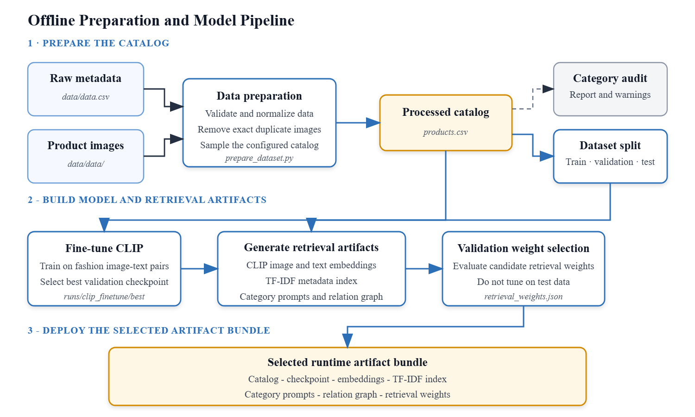
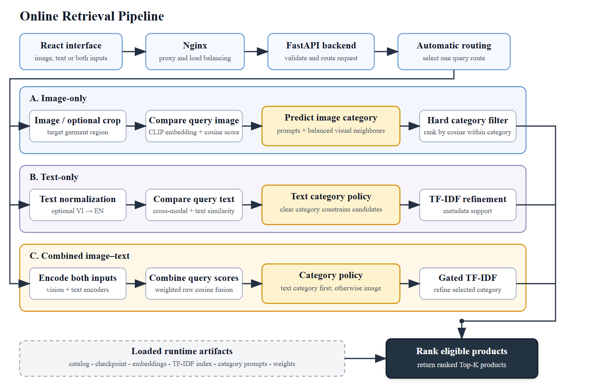

# Category-Aware Multimodal Fashion Retrieval using CLIP

Hệ thống tìm và xếp hạng sản phẩm thời trang có sẵn trong catalog từ **ảnh**, **văn bản** hoặc **cả hai**. Kết quả là danh sách Top-K sản phẩm tương tự, không phải gợi ý phối đồ hay chức năng mua hàng.

## Vấn đề hệ thống giải quyết

Người dùng có thể thấy một món đồ trong ảnh nhưng không biết tên để gõ tìm kiếm. Ngược lại, họ có thể mô tả loại sản phẩm và màu sắc mong muốn nhưng không có ảnh mẫu. Khi ảnh chứa người, phông nền hoặc nhiều món đồ, tìm theo hình dáng đơn thuần cũng dễ trả về sai loại sản phẩm. Hệ thống cho phép dùng thông tin đang có để tìm trong cùng một catalog; người dùng có thể kết hợp ảnh với mô tả để làm rõ sản phẩm cần tìm.

## Tóm tắt

CLIP được fine-tune trên các cặp ảnh–mô tả thời trang để mã hóa truy vấn và sản phẩm. Hệ thống dùng cosine similarity để so sánh các embedding, kết hợp thêm mức khớp từ khóa TF-IDF khi có văn bản. Với truy vấn ảnh, bằng chứng từ sản phẩm tương tự và các câu mô tả danh mục giúp dự đoán loại sản phẩm; bản website hiện chỉ xếp hạng trong danh mục được chọn (**Hard Category**). Dự án so sánh các mô hình và chiến lược xếp hạng trên ba catalog lấy mẫu độc lập, mỗi catalog gồm 5.000 sản phẩm. Kết quả thực nghiệm phản ánh mức khớp theo danh mục và cặp ảnh–văn bản trong các tập dữ liệu đó, không đo đầy đủ mức độ hợp gu của từng người dùng.

## Quy trình hoạt động

**Ngoại tuyến:** kiểm tra dữ liệu và ảnh → lấy mẫu catalog, thống kê phân bố danh mục → chia train/validation/test → fine-tune CLIP → tạo embedding ảnh và văn bản → xây chỉ mục TF-IDF → chọn trọng số truy xuất trên validation. Các artifact vận hành được tạo và lưu trong `project/`; website không lấy checkpoint, embedding hay trọng số từ `experiments/`.



**Trực tuyến:** giao diện gửi ảnh, văn bản hoặc cả hai → Nginx chuyển yêu cầu tới FastAPI → hệ thống mã hóa truy vấn, tính điểm và chọn tập ứng viên → trả Top-K. Ba luồng được xử lý như sau:



| Truy vấn | Cách xếp hạng hiện tại |
| --- | --- |
| Chỉ ảnh | So sánh ảnh truy vấn với ảnh catalog; dự đoán một danh mục từ bằng chứng thị giác và CLIP category prompts; xếp hạng các sản phẩm trong danh mục đó. |
| Chỉ văn bản | Kết hợp mức khớp text→image và text→text với TF-IDF của tên, mô tả. Chỉ giới hạn vào một danh mục khi truy vấn nêu rõ đúng một danh mục. |
| Ảnh + văn bản | Kết hợp điểm ảnh và văn bản. Danh mục nêu rõ trong văn bản được ưu tiên; nếu không có, dùng danh mục dự đoán từ ảnh. TF-IDF tinh chỉnh thứ hạng trong danh mục đã chọn. |

Ảnh có thể được crop thủ công để tập trung vào sản phẩm cần tìm. Bộ lọc đối tượng `Nữ / Nam / Trẻ em / Unisex` là tùy chọn riêng do người dùng chọn; hệ thống không suy đoán giới tính từ ảnh. Website còn có duyệt danh mục, chi tiết sản phẩm, Favorites, lịch sử tìm kiếm trên thiết bị và trang Developer.

## Category-Aware Ranking đã phát triển

Ban đầu, sản phẩm được xếp hạng theo độ tương đồng mà không xét danh mục. Dự án đã thử các cách xử lý danh mục để giảm việc một loại sản phẩm khác chen vào Top-K:

1. **Hard filter:** chỉ xếp hạng sản phẩm thuộc danh mục được chọn hoặc dự đoán.
2. **Soft support:** cộng một mức hỗ trợ cố định cho sản phẩm cùng danh mục, vẫn giữ các danh mục khác trong tập ứng viên.
3. **Confidence-weighted support:** điều chỉnh mức hỗ trợ theo độ tin cậy của dự đoán danh mục.
4. **Dynamic relation-aware support:** xét thêm quan hệ giữa các danh mục gần nhau và phân bổ mức hỗ trợ tùy tình huống.

**Bản website hiện triển khai hard filter** cho ảnh và truy vấn kết hợp. Danh mục ảnh được dự đoán bằng hai nguồn: các sản phẩm tương tự nhất được lấy cân bằng theo từng danh mục và độ khớp giữa ảnh truy vấn với các câu CLIP prompt mô tả danh mục. Cách này đạt kết quả cao nhất trong thí nghiệm dùng *cùng danh mục* làm tiêu chí đúng. Hạn chế của nó là nếu dự đoán sai danh mục, sản phẩm phù hợp ở danh mục khác sẽ bị loại; người dùng có thể crop lại ảnh hoặc thêm mô tả nêu rõ loại sản phẩm. Các cách soft và dynamic được giữ trong hồ sơ thí nghiệm để giải thích quá trình phát triển, không phải lựa chọn trên website hiện tại.

## Giới hạn của hệ thống

- Hệ thống chỉ trả sản phẩm có trong catalog đã chuẩn bị; dữ liệu nguồn thiếu hoặc gắn sai danh mục sẽ ảnh hưởng kết quả.
- Nếu dự đoán sai danh mục ảnh, Hard Category có thể loại sản phẩm đúng. Cắt lại ảnh hoặc nêu rõ loại sản phẩm trong mô tả có thể giúp sửa truy vấn.
- Ảnh có nhiều món đồ, người hoặc phông nền phức tạp vẫn cần người dùng chọn vùng ảnh phù hợp; hệ thống chưa tự tách từng trang phục.
- TF-IDF chỉ hỗ trợ những chi tiết có trong tên hoặc mô tả sản phẩm. Từ quá chung chung, thuộc tính không được ghi lại hoặc ảnh và văn bản mâu thuẫn có thể cho kết quả kém ổn định.
- Thí nghiệm dùng ba mẫu từ cùng một nguồn dữ liệu và chủ yếu đánh giá theo danh mục. Các số đo này chưa chứng minh chất lượng trên mọi catalog hoặc mức phù hợp về màu, kiểu dáng và sở thích cá nhân.

## Cấu trúc và cách chạy

| Thư mục | Vai trò |
| --- | --- |
| [`project/`](project/) | Pipeline chuẩn bị dữ liệu, huấn luyện, artifact vận hành và website. Có thể đóng gói riêng thành `source/`. |
| [`experiments/`](experiments/) | Script và kết quả so sánh các mô hình, chiến lược xếp hạng; không phải đầu vào của website. |
| [`docs/reports/evidence/final_experiments/`](docs/reports/evidence/final_experiments/) | Bảng kết quả và hồ sơ chạy cuối cùng. |

Đọc [hướng dẫn chạy trong project/README.txt](project/README.txt) để biết yêu cầu phần mềm, cấu trúc dataset và từng lệnh chuẩn bị catalog, fine-tune, sinh embedding, chọn trọng số và khởi động Docker. Tên thư mục sau khi clone có thể thay đổi; các lệnh trong hướng dẫn được chạy từ bên trong `project/` hoặc bản nộp `source/`.

Khi đã có đủ artifact và `.env`, khởi động từ thư mục `project/`:

```powershell
docker compose config --quiet
docker compose up -d --build
```

Website ở `http://localhost`, Swagger ở `http://localhost/docs`, Developer Dashboard ở `http://localhost/developer`.

Chi tiết thí nghiệm và cách đọc bảng kết quả nằm tại [experiments/model_comparison/README.md](experiments/model_comparison/README.md) và [hồ sơ kết quả cuối](docs/reports/evidence/final_experiments/README.md). Các baseline chỉ dùng model và raw cosine được trình bày riêng với pipeline hoàn chỉnh vì pipeline còn áp dụng lọc danh mục và TF-IDF.
